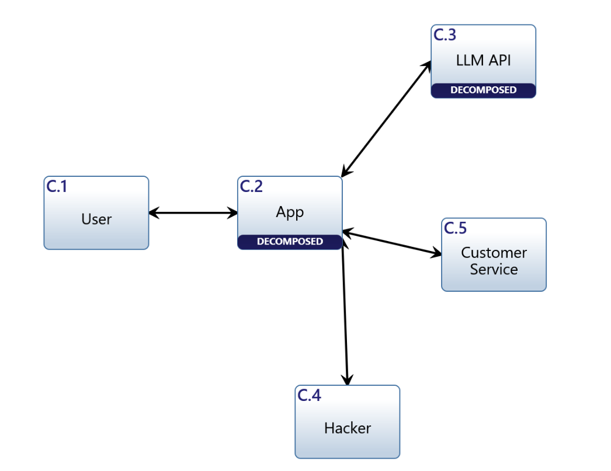

# README for SYSEN5151 Semester Project

## Project Name - Recipe Roulette
### Team Members - Zachary Adornato, Jacob Brown, Ethan Gates, Stephen Gyurits

## Operational Concept
Meal planning is a time-consuming laborious process that everyone deals with. Dietary constraints and budget can complicate recipe selection and make the process even more difficult. The Recipe Roulette app is a system that generates relevant recipes while keeping budget, dietary restrictions, budget, and preferences in mind. 

Individuals that struggle with the previously mentioned constraints are the primary audience to experience meal planning issues. Existing meal planning leads to a non-nutritional diet, improper budgeting, and meals that take longer to shop for than they do to cook. There is a clear difficulty in balancing: cost, dietary restrictions, and preferences while maintaining a nutritional and healthy diet.

<p align="center">

</p>

## Development Setup

The project targets Python 3.12. From the repository root, create and activate a virtual environment, then install the project dependencies:

```powershell
py -3.12 -m venv .venv
.\.venv\Scripts\Activate.ps1
python -m pip install -r requirements.txt
```

## Run the Flask Foundation

Start the web application. Recipe generation defaults to its deterministic
stub. Grocery pricing defaults to local coursework HTML fixtures; those
illustrative fixture prices are not live retailer prices and no grocery
website is contacted.

```powershell
python -m app
```

Open [http://127.0.0.1:5000](http://127.0.0.1:5000) in a browser. Recipe
generation and grocery pricing are configured independently.

### Grocery pricing

The default `GROCERY_PRICING_MODE=html_fixture` retrieves saved local HTML
product listings and exercises parsing, product matching, unit conversion,
and package costing. Fixture values are coursework test inputs only; they
must not be cited as current grocery prices or as live S.1 scraping
measurements. Live webpage retrieval is disabled until a source and its
automated-use permission are explicitly approved.

```powershell
$env:GROCERY_PRICING_MODE = "html_fixture"
python -m app
```

The fixture catalog uses a project-owned HTML product-card structure. A
replaceable `HtmlPageRetriever` boundary separates page retrieval from HTML
parsing and the reusable extraction, matching, normalization, and costing
logic. In `html_fixture` mode the retriever reads local files only; Kroger API
credentials and HTTP requests are used only in separately configured `kroger`
mode. Unknown products, ambiguous
matches, missing or malformed prices, and incompatible units fail explicitly;
there is no silent fallback to stub prices.

The browser uses `POST /api/v2/recipes`. It labels prorated ingredient-use
cost separately from whole-package checkout estimates. The existing
`POST /api/v1/recipes` contract and cost semantics are preserved. In explicit
stub mode, package-purchase amounts are returned as unavailable rather than
being inferred from demo prices. The versioned response is documented in
[api-v2.yaml](contracts/api-v2.yaml).

For offline demonstrations, select the existing deterministic dictionary
explicitly:

```powershell
$env:GROCERY_PRICING_MODE = "stub"
python -m app
```

Set `GROCERY_PRICING_MODE=html_live` to verify the fail-closed behavior; it
returns a safe unavailable response and performs no network request. See
[ADR 0002](docs/adr/0002-kroger-products-api.md) and
[pricing traceability](docs/traceability.md) for the final API source decision
and its Innoslate deviation.

### Optional live Kroger Products API pricing

The team-selected live pricing source is the documented Kroger Products API,
not webpage scraping. Keep `html_fixture` as the default until credentials,
location, and the controlled smoke test have been reviewed. Register an
application with [Kroger Developers](https://developer.kroger.com/), then set
its credentials and an eight-character location ID in the server environment:

```powershell
$env:GROCERY_PRICING_MODE = "kroger"
$env:KROGER_CLIENT_ID = "<server-side-client-id>"
$env:KROGER_CLIENT_SECRET = "<server-side-client-secret>"
$env:KROGER_LOCATION_ID = "<eight-character-location-id>"
python -m app
```

Kroger receives recipe ingredient search terms, including ingredients marked
as owned, and the configured location ID. Budget, dietary restrictions, and
the user's ownership list are not sent. The adapter does not persist product
responses, does not compare retailers, does not retry failed requests, and
never substitutes fixture or stub prices after an API error. Price and
availability are location-specific and may change. The UI identifies this
mode as live Kroger API pricing and distinguishes it from HTML fixtures.

OpenAI is instructed to include recipe-required varieties or forms in
ingredient names, without invented brands or unnecessary qualifiers. This is
a generation instruction, not a guarantee of semantic correctness. Ownership
is checked separately: exact names remain supported, and only a controlled
set of standard dry-pasta names and shapes can match generically. Other form
or variety differences remain unconfirmed rather than being treated as
interchangeable.

After separately approving one live request, the controlled smoke test is:

```powershell
python -m scripts.smoke_test_kroger --live
```

It defaults to one `chicken breast` requirement (`16 oz`), requires typing
`RUN ONE KROGER SMOKE TEST WITH CAP 2`, and permits at most two HTTP requests:
one OAuth token request and one product search. It stops on the first failure
and does not retry. The command was not run during this implementation.

### Optional OpenAI recipe generation

The default `RECIPE_GENERATION_MODE=stub` requires no account or API key. To enable live recipe generation, create an OpenAI API project/key with billing enabled, then set the variables in the server's environment before starting the application. In PowerShell:

```powershell
$env:RECIPE_GENERATION_MODE = "openai"
$env:OPENAI_API_KEY = "<your-server-side-api-key>"
$env:OPENAI_MODEL = "gpt-6-luna"
python -m app
```

Keep the key in the process environment; do not put it in source files or browser code. `.env` files are ignored and are not loaded by the application. OpenAI usage can incur charges, including on retries; check current provider pricing. The application does not enforce a cumulative spend limit or cache generated recommendations. Ingredients, budget, and dietary restrictions are sent to OpenAI in live mode. Recipe generation is not guaranteed to enforce dietary restrictions; verify ingredients and allergens yourself. The modeled login prerequisite remains simulated and does not authenticate users.

Set `$env:RECIPE_GENERATION_MODE = "stub"` to return to the deterministic local recipes.

## Run the Console Walking Skeleton

The original interactive console workflow remains available explicitly. It
uses the configured local HTML fixture source by default; set stub mode for
the deterministic dictionary:

```powershell
$env:GROCERY_PRICING_MODE = "stub"
python -m app --cli
```

## Run Automated Tests

Run the test suite from the repository root:

```powershell
python -m pytest
```

## Chapter 10.4 Pricing Benchmarks

The local benchmark measures the existing in-memory ingredient-price lookup
and Python processing. The fixture benchmark measures saved HTML retrieval,
parsing, matching, normalization, and cost processing without external HTTP.
Neither measures live webpage latency, recipe generation, browser input, or a
database query.

Run 30 local measurements:

```powershell
python -m scripts.benchmark_pricing --mode local --runs 30 --max-requests 30
```

Run 30 deterministic HTML fixture measurements (no `--live` flag is used and
no network requests are made):

```powershell
python -m scripts.benchmark_pricing --mode html-fixture --runs 30 --output results/chapter11/html-fixture-30.csv
```

LLM pricing is experimental and returns unverified estimates, not store
prices. It is isolated from Recipe Roulette's production recipe/pricing path.
Live requests require `--mode llm --live`, an explicit per-invocation cap, and
typing the confirmation phrase. The SDK retry count is zero, so a 30-run
benchmark sends at most 30 API requests. Each request may incur charges.

After separately reviewing and approving the live experiment, configure
`OPENAI_API_KEY` and, optionally, `OPENAI_MODEL` in the process environment,
then run:

```powershell
python -m scripts.benchmark_pricing --mode llm --live --runs 30 --max-requests 30 --output results/chapter10-4/llm-pricing-30.csv
```

For a separately authorized 30-run Kroger API benchmark, the fixed five-item
basket can generate up to six HTTP requests per workflow: one OAuth token and
five product searches. The script requires `--live`, an explicit cap, and an
interactive confirmation; it stops after the first failed workflow and
refuses to overwrite a result file:

```powershell
python -m scripts.benchmark_pricing --mode kroger --live --runs 30 --max-requests 180 --output results\chapter11\kroger-api-30.csv
```

The benchmark refuses to overwrite a result CSV. Choose a new filename for
each run. Timings use nanoseconds and include per-stage status and retry
counts. Summarize and compare measurement files with the team-provided
Innoslate simulation reference, writing to a new analysis directory so prior
results are preserved:

```powershell
$runTag = Get-Date -Format "yyyyMMddTHHmmss"
python -m scripts.analyze_pricing_benchmark --input results/chapter11/html-fixture-30.csv --output-dir "results/chapter11/analysis-$runTag"
```

For an authorized Kroger API benchmark, analyze its CSV in another new
directory (the API results are a source substitution, not literal webpage
scraping timings):

```powershell
$runTag = Get-Date -Format "yyyyMMddTHHmmss"
python -m scripts.analyze_pricing_benchmark --input results\chapter11\kroger-api-30.csv --output-dir "results\chapter11\kroger-analysis-$runTag"
```

See [the Chapter 10.4 methodology](docs/performance/chapter10-4-methodology.md)
for modeled action traceability, CSV columns, simulation values, and comparison
limitations. Historical Chapter 10 and pre-replacement Chapter 11 result files
are retained. Fixture results are not comparable to S.1's simulated webpage
round trips. The current XML export contains no S.3 pricing sequence; do not
treat the experimental LLM run as an implemented or simulated S.3 scenario.